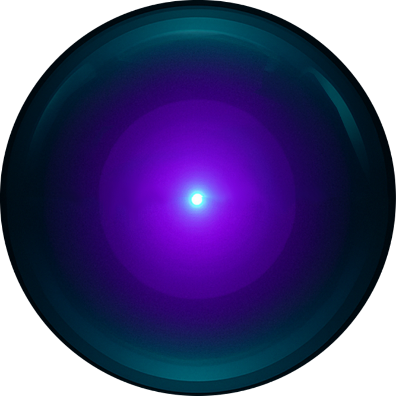
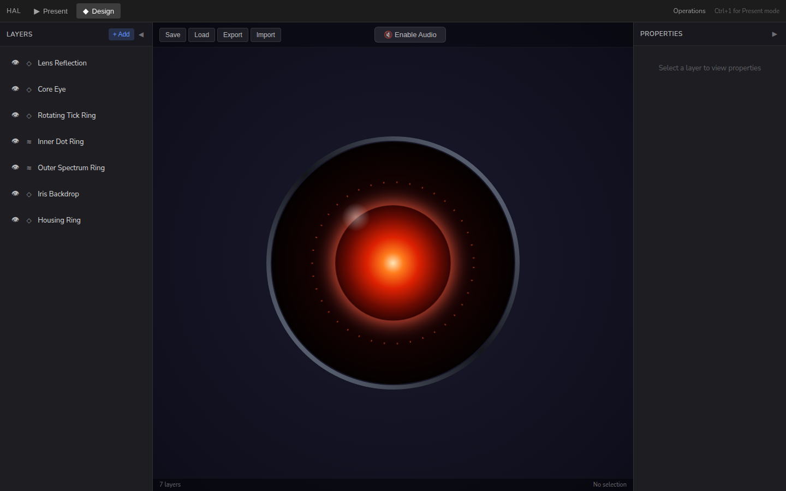
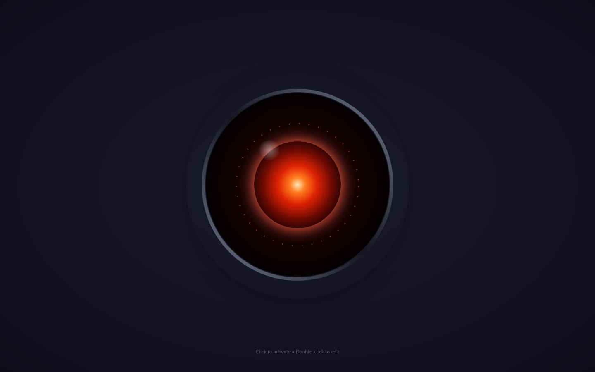
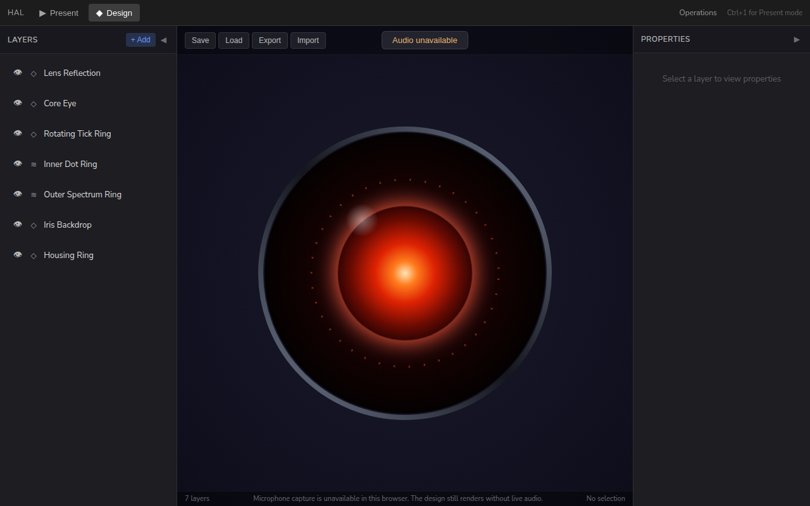
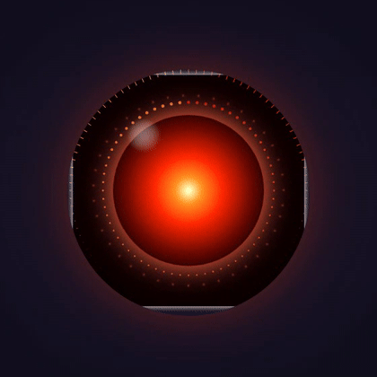
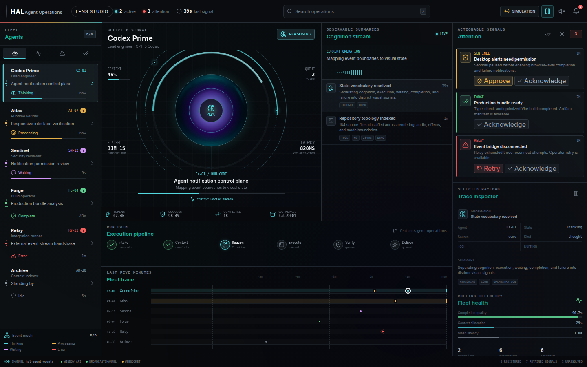

<div align="center">



# HAL Lens Studio

**A browser-based audio-reactive visual design tool.**

Compose layered lens designs, drive them from the microphone, and present them full screen. The same app also includes the HAL agent operations console.

</div>

## Quick start

Requires Node.js `^20.19.0` or `>=22.12.0`.

```bash
npm install
npm run dev
```

| Surface | URL |
| --- | --- |
| Lens Studio | http://localhost:5173/studio |
| Agent operations | http://localhost:5173/ |

The studio opens on the default HAL eye. **Design** edits layers. **Present** fills the screen. **Enable Audio** asks for the microphone and maps the signal onto the design. If the browser has no Web Audio API or no microphone, the eye still renders and the status bar explains why.

```bash
npm run build
npm run preview
```

## Screenshots

Design mode, with the default seven-layer eye:



Present mode:



The same design when microphone capture is unavailable. The canvas stays up, and the control reports that live audio cannot start:





Agent operations, the live fleet console at `/`:



## Features

- **Layer composer** for shapes, gradients, images, equalizer rings, radial text, and effects, with visibility, order, opacity, blend, and transform controls.
- **Default HAL eye** so a new session already has a complete lens design.
- **Design and present modes**, including keyboard shortcuts (`Ctrl+1` present, `Ctrl+2` design).
- **Microphone-reactive visuals.** Volume, bass, mid, treble, and beat can drive layer properties through the equalizer pipeline.
- **Graceful audio fallback.** Missing Web Audio, a missing microphone, or a denied permission leaves the design interactive and shows a plain-language reason. Alert tones in the operations console fail the same way.
- **Saved designs.** Save, load, export, and import presets. Layer metadata stays in `localStorage`; image bytes stay in IndexedDB.
- **Radial symmetry** for equalizer rings, including mirror and n-fold layouts.
- **Frost Glass themes.** The interface uses the Frost Glass CSS library in frost-dark and frost-light.
- **Agent operations console** for fleet identity, a semantic lens, a bounded cognition stream, an attention queue, a five-minute trace, and optional desktop notifications.
- **Live event bridge.** DOM events, `BroadcastChannel`, `window.HAL_AGENT_NOTIFICATIONS`, and an optional WebSocket. `npm run dev:live` starts the localhost Codex sidecar.

## Agent operations

The console starts in labeled simulation mode and can be paused from the top bar. **Lens Studio** in the header opens the visual designer. **Operations** in the studio bar returns to the console.

For real Codex session telemetry:

```bash
npm run dev:live
```

The sidecar binds `127.0.0.1:8765`, accepts the local Vite origins, and by default includes only sessions whose `cwd` matches the repository where it was started. Override that filter with `HAL_WORKSPACE=/absolute/path`. The bridge is read-only: operator commands receive a correlated rejection rather than controlling a Codex process without an explicit command adapter.

```dotenv
VITE_HAL_AGENT_WS_URL=ws://127.0.0.1:8765/hal-agent-events
```

See [Agent Event Bridge](docs/agent-event-bridge.md) for the event payload, transports, validation, and security boundaries.

| Surface | Direction | Name |
| --- | --- | --- |
| DOM CustomEvent | Inbound | `hal:agent-event` |
| DOM CustomEvent | Outbound | `hal:agent-command` |
| BroadcastChannel | Inbound | `hal-agent-events` |
| BroadcastChannel | Outbound | `hal-agent-commands` |
| Window API | Both | `window.HAL_AGENT_NOTIFICATIONS` |
| WebSocket | Both | `VITE_HAL_AGENT_WS_URL` |

Inbound WebSocket messages are one event or an array of events. Outbound commands use `{ "type": "agent.command", "command": { ... } }`. A live socket stops the demo stream. If the socket drops, resuming the simulation restores the demo fleet, and the top-bar reconnect control attaches the live stream again.

## Static demo

`npm run build` writes a static site to `dist/`.

- **Vercel:** [`vercel.json`](vercel.json) builds the Vite app and rewrites client routes to `index.html`. The base path stays `/`.
- **GitHub Pages:** [`.github/workflows/pages.yml`](.github/workflows/pages.yml) builds with `VITE_BASE_PATH=/<repository>/`, copies `index.html` to `404.html` for client-side routes, and publishes the `dist` directory. Enable Pages with the GitHub Actions source after this workflow is on `master`.

Pull requests run [`.github/workflows/ci.yml`](.github/workflows/ci.yml), which typechecks, lints, tests, builds, and uploads the `dist` artifact.

## Quality commands

```bash
npm run type-check
npm test -- --runInBand
npm run test:bridge
npm run lint
npm run build
```

## Stack

React 19, TypeScript 6, Vite 8, Jest 30, Testing Library, and the Web Audio API.

TypeScript 7 and ESLint 10 are published, but the current typescript-eslint release only accepts TypeScript below 6.1, ts-jest only accepts TypeScript below 7, and eslint-plugin-react 7.37 only accepts ESLint 9. This repo uses the newest versions those tools can actually run: TypeScript 6.0 and ESLint 9.39.

## Attribution

The interface is built with [Frost Glass CSS](https://github.com/frost-glass-css/frost-glass-css) by Frosty40, kept in `src/themes/frost-glass.css` under the MIT license.

## License

[MIT](LICENSE) © 2026 newjordan
